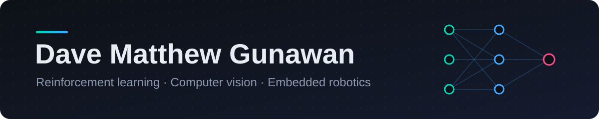

  

### About

I'm a student engineer who likes building things end to end: training the model, writing the simulator, and shipping it
to something you can actually run, whether that's a browser, a desktop app or a Raspberry Pi.

- 🏎️ Training **reinforcement-learning agents** in GPU simulators and running them live in the browser
- 👁️ Building **computer-vision + voice** assistive devices on embedded hardware
- 🤖 Exploring **LLM-driven agents** constrained by deterministic game engines
- 🏆 **Silver**, YISF, for SpectraSense

### Tech

  
  
  
  
  
  
  
  
  
  
  
  

### Featured projects

<table>
  <tr>
    <td colspan="2">
      <a href="https://github.com/DMVexious/apexrl"><b>🏎️ APEX-RL</b></a> &nbsp;·&nbsp; PyTorch · ONNX · Three.js · Rapier 
      End-to-end RL racing. A PPO policy is trained on 4,096 parallel cars in a custom CUDA simulator, then driven live in the
      browser through ONNX Runtime across four physics-distinct maps with obstacles, crosswind and ice.  
      
    </td>
  </tr>
  <tr>
    <td width="50%" valign="top">
      <a href="https://github.com/DMVexious/project-genesis"><b>🌱 Project Genesis</b></a> 
      C++ · Python · FastAPI · Phaser · Tauri  
      An emergent 2D society sim. A deterministic C++ engine owns the physics, and local-LLM NPCs (grammar-constrained,
      with RAG memories and genetics) live, build, fight and reproduce. Packaged as a desktop app.
    </td>
    <td width="50%" valign="top">
      <a href="https://github.com/DMVexious/SpectraSense"><b>👁️ SpectraSense</b></a> &nbsp;🥈 YISF Silver 
      Raspberry Pi 5 · YOLO · OCR · Vosk · Ollama  
      An assistive IoT device for the visually impaired. It reads text aloud, recognises Indonesian currency and objects,
      and answers spoken questions, all with audio feedback.
    </td>
  </tr>
</table>
